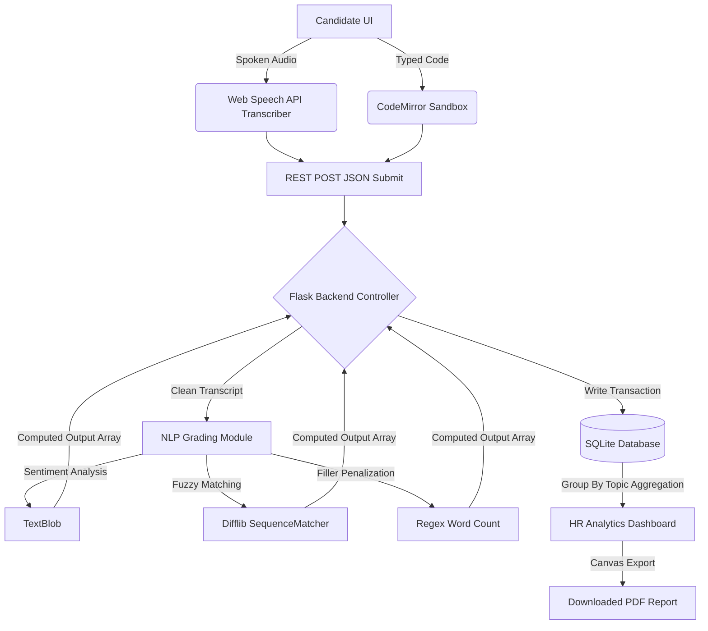

<h1 align="center">🤖 AI Automated Interview Analyzer</h1>

<p align="center">
  <strong>An advanced, end-to-end full-stack web application designed to automatically interview, transcribe, evaluate, and profile job candidates using Natural Language Processing (NLP) and robust Anti-Cheat mechanics.</strong>
</p>

<p align="center">
  
  
  
  
  
</p>

---

## 🌟 Overview
Traditional interviews require massive amounts of HR man-hours to administer, record, and grade. The **AI Automated Interview Analyzer** solves this by acting as a completely autonomous, specialized technical recruiter. 

Whether testing for **Machine Learning Theory**, **Web Development knowledge**, or requesting actual **Python/JavaScript algorithm code**, the system walks candidates step-by-step through a virtual assessment, listening to their answers, grading them instantly using NLP logic algorithms, and compiling visually stunning PDF Evaluation Reports for Human Resources.

---

## 🚀 Key Features

### 🎙️ 1. Multi-Modal Candidate Portal
- **Web Speech API Target:** The candidate can answer theoretical questions out loud. The cutting-edge Web Speech API listens and flawlessly transcribes spoken audio directly into frontend text in real-time.
- **Virtual Audio Interviewer:** To increase accessibility and user experience, candidates can press `🔊` to have the system physically read the complex technical questions out loud to them using Text-to-Speech (TTS).
- **Embedded CodeMirror IDE:** For coding rounds (`JavaScript Algorithms`, `Python Programming`), the system features an embedded **Code Editor** with Dracula syntax-highlighting, auto-indentation, and dynamic language toggling.

### 🛡️ 2. Comprehensive Anti-Cheat Engine
- **Focus Monitor Tracking:** If a candidate attempts to switch browser tabs or minimize the window to Google an answer, the JavaScript event-listener flags the violation and alerts HR.
- **Copy/Paste Blockades:** The answer portals physically intercept and prevent `CTRL+V` actions to deter pasting pre-written essays from ChatGPT or local notes.
- **Aggressive Time Constraints:** A dynamic, localized 90-second countdown forces the candidate's answer through instantly on timeout, halting procrastination.

### 🧠 3. Advanced NLP Grading Algorithm
- **Semantic Mapping (difflib):** Analyzes the exact similarity ratio of the candidate's transcript against the HR-defined expected answer.
- **Keyword Extraction:** Validates the existence of critical technical vocabulary inside the candidate's transcript required for a passing grade.
- **Confidence & Polarity Index:** Utilizes `TextBlob` to calculate emotional confidence and subjectivity mapping during the interview. 
- **Verbal Penalty System:** actively scans, counts, and docks `Communication` points if the candidate relies too heavily on filler words (e.g., *"um"*, *"literally"*, *"basically"*, *"like"*). 

### 📈 4. HR Analytics Dashboard
- **Radar Profiling:** Every candidate summary includes an interactive `Chart.js` 5-Axis Radar graph mapping their *Tech Alignment, Relevance, Confidence, Communication, and Final Score*.
- **PDF Generation:** HR administrators can click `Download PDF` to instantly render the full DOM and convert the graphical AI profile into a printable HR document using `html2canvas` and `jsPDF`.
- **Topographical Aggregation:** Candidate performance is seamlessly grouped by Topic (e.g., *John Doe - Web Development - 5 Questions Answered*), rather than cluttering the database horizontally.

---

## 🏗️ System Architecture 



---

## ⚙️ Local Setup Instructions

1. **Clone the repository:**
   ```bash
   git clone https://github.com/charannadapana/AI-INTERVIEW-ANALYSER.git
   cd ai-interview-analyzer
   ```
2. **Setup the Virtual Environment & Dependencies:**
   ```bash
   python -m venv venv
   .\venv\Scripts\activate
   pip install -r requirements.txt
   ```
3. **Download AI Corpora (TextBlob dependencies):**
   ```bash
   python -m textblob.download_corpora
   ```
4. **Seed the database (Optional but Recommended to get Coding Questions):**
   ```bash
   python add_coding_questions.py
   ```
5. **Run the Server:**
   ```bash
   python app.py
   ```

**Access Points:**
- **Candidate Login:** `http://127.0.0.1:5000/`
- **HR Dashboard Login:** `http://127.0.0.1:5000/` -> *(Click 'HR Login', Username: `admin`, Password: `admin123`)*

---

## 🎨 Design & Aesthetic
The UI was meticulously constructed without heavy CSS frameworks, relying purely on **Custom Vanilla CSS** targeting the modern, premium **Glassmorphism** visual language. 
- Translucent frosted-glass panels (`backdrop-filter: blur()`).
- High-contrast animated gradient backgrounds.
- State-aware loading overlays prioritizing seamless user experience.
